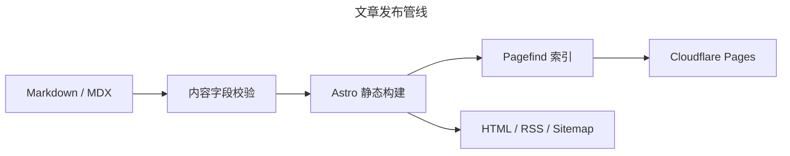

这个博客使用 Astro 生成静态页面，文章保存在 Markdown 文件中。代码、图表和公式需要在不同设备上
保持可读，源文件也要适合版本控制。

> **渐进增强约束：** 即使 JavaScript 没有执行，正文、代码、公式和 Mermaid 源码仍然可见。
> JavaScript 只把图表源码变成 SVG，并增加主题切换、复制按钮和全文搜索。

## Markdown 是内容边界

文章使用 Astro 内容集合管理。frontmatter 是构建系统与作者之间的稳定契约：

```yaml
---
title: 我的第一篇文章
description: 一句话摘要
publishDate: 2026-07-29
tags:
  - Astro
  - Markdown
---
```

构建时会检查字段类型。普通文章自动进入首页、归档、标签页、搜索、RSS 和站点地图；
`unlisted: true` 的文章只通过固定链接访问，`draft: true` 的文章则不生成路由。

### GFM 与结构化内容

常见的 GitHub Flavored Markdown 语法可以直接使用：

| 能力           | 输入                 | 输出阶段   |
| -------------- | -------------------- | ---------- |
| 代码高亮       | fenced code block    | 构建时     |
| 数学公式       | `$...$` 或 `$$...$$` | 构建时     |
| Mermaid        | `mermaid` code fence | 浏览器增强 |
| 表格、任务列表 | GFM                  | 构建时     |

- [x] 中文正文与标点排版
- [x] 可横向滚动的宽表格
- [x] 可复制的高亮代码
- [x] 二级、三级标题目录

## 代码应当可以阅读和复制

Shiki 在构建时生成语法高亮，并同时写入浅色与深色主题令牌。复制按钮不会改变代码本身：

```ts
type Evidence<T> = {
  observation: T
  establishes: string
  doesNotEstablish: string
}

export function accept<T>(evidence: Evidence<T>): boolean {
  return evidence.establishes.length > 0 && evidence.doesNotEstablish.length > 0
}
```

代码块保留横向滚动，不会为了适配窄屏而折断标识符。键盘用户可以聚焦复制按钮；关闭脚本后，
代码仍是普通的 `<pre><code>`。

## Mermaid 表达关系

图表使用文本源码进入 Git，便于评审差异。下面的流程说明从源文件到线上页面的路径：



主题切换时，图表会用对应的语义颜色重新渲染。渲染失败时控制台会记录错误，原始文章仍可从
Markdown 源文件恢复。

## LaTeX 保留数学语义

行内公式适合短表达，例如质能方程 $E = mc^2$。块级公式用于需要独立阅读的推导：

$$
\operatorname{softmax}(x_i) =
\frac{\exp(x_i)}{\sum_{j=1}^{n}\exp(x_j)}
$$

再看一个带边界的积分：

$$
\int_0^1 x^2\,\mathrm{d}x =
\left[\frac{x^3}{3}\right]_0^1 =
\frac{1}{3}
$$

公式由 KaTeX 在构建时转成 HTML 与 MathML。MathML 为辅助技术提供机器可读结构，CSS 只负责视觉排版。

## 设计系统是约束，不是皮肤

本站从三个设计系统中采用可验证的规则：

1. GOV.UK Design System：从小屏单列开始，限制正文行宽，先写语义 HTML，为重复导航提供跳转链接，
   并使用在明暗背景上都清楚的黄黑焦点状态。
2. Carbon Design System：间距集中到有限令牌，元素沿关键线对齐，编辑性标题与功能性元数据使用不同
   字体层级，桌面布局落在响应式网格上。
3. Primer：链接用于导航，按钮用于动作；当前页面写入 `aria-current`；键盘顺序与视觉顺序一致；
   颜色按角色命名，并为减少动态效果的系统偏好关闭非必要过渡。

这些规则比某个截图更稳定。页面可以换配色或字体，但语义、顺序、行宽、焦点和降级路径不应退化。

## 构建结果必须可验证

项目的 `pnpm test` 不把“成功生成 dist”当作唯一证据。它还检查关键路由、RSS、Pagefind 索引、
KaTeX 标记、Mermaid 源码、主要内容跳转目标与目录导航。

最终仍需要真实浏览器检查，因为类型系统不能证明移动端菜单可操作、焦点可见或图表在深色主题下可读。
自动检查与人工视觉审查各自覆盖不同风险。
